# MeshFabric Android App

English | [Español](README_ES.md)

MeshFabric is an unofficial native Android client for MeshCentral. It provides remote desktop, interactive terminal, file management, device notes, remote actions, and a Log view with Activity and Events tabs without embedding the MeshCentral web administration interface. The terminal uses locally bundled xterm.js assets inside an Android WebView.

Availability depends on the MeshCentral server, account permissions, remote agent, operating system, and remote session. MeshFabric is not a replacement for the full MeshCentral administration console.

## Screenshots

<!-- screenshot-gallery:start -->
<table>
  <tr>
    <td align="center">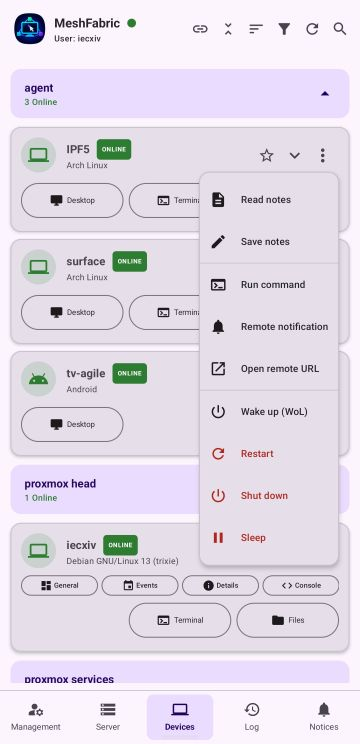<br>Device actions</td>
    <td align="center">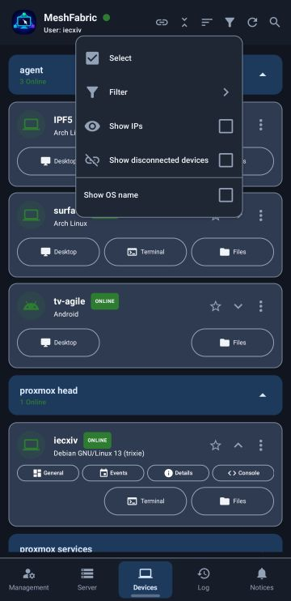<br>Device filters</td>
    <td align="center">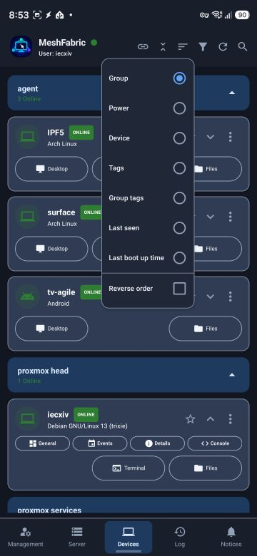<br>Device sorting</td>
    <td align="center">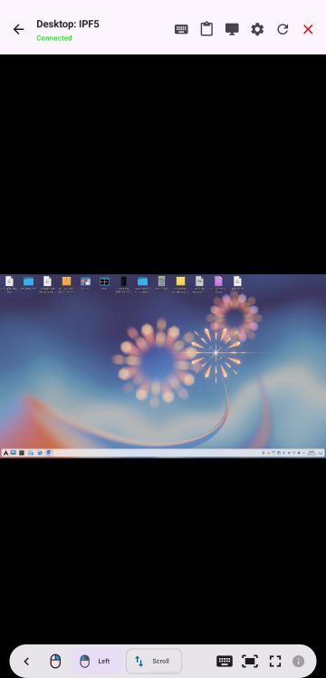<br>Remote desktop</td>
  </tr>
  <tr>
    <td align="center">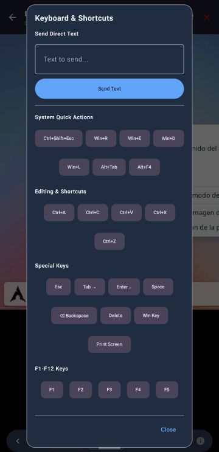<br>Keyboard and shortcuts</td>
    <td align="center">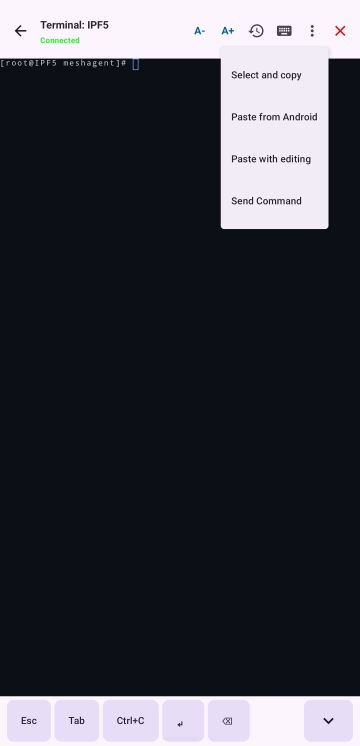<br>Terminal</td>
    <td align="center">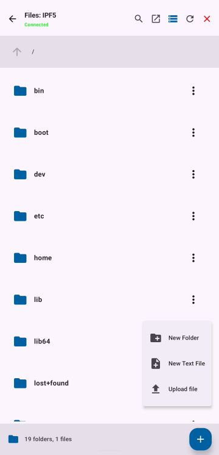<br>File manager</td>
    <td align="center">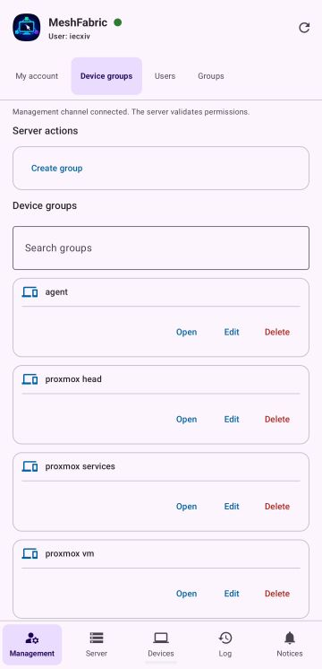<br>Device groups</td>
  </tr>
  <tr>
    <td align="center">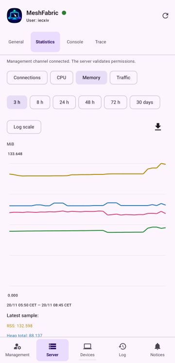<br>Server statistics</td>
    <td align="center">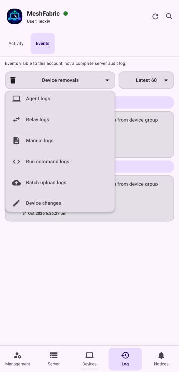<br>Events</td>
    <td align="center">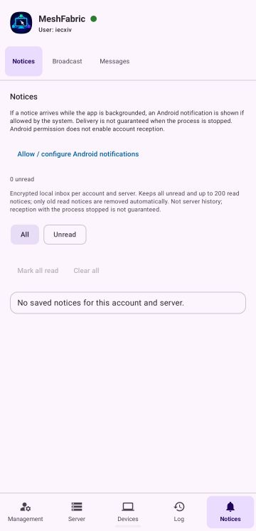<br>Notices</td>
    <td align="center">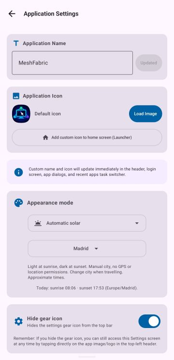<br>Application settings</td>
  </tr>
</table>
<!-- screenshot-gallery:end -->

## Features

### Devices and navigation

- Browse devices grouped by their MeshCentral device groups, with online/offline status and operating-system information.
- Expand or collapse individual groups or all groups, with saved group expansion preferences.
- Search the device list by name or operating system.
- Use the bottom navigation bar for Management, Server, Devices, Log and Notices.
- Access desktop, terminal, file sessions, and device actions from each device card.
- Expand the card options to open General, Events, Details and the agent Console. Details remains available there without a duplicate information icon beside ONLINE/OFFLINE.
- Header filters control offline-device and network-address visibility.

### Device browsing and batch actions

- Sort and filter devices, keep local favorites, select visible devices or groups, and export a reviewed selection as JSON.
- The operating-system name preference is enabled by default when no choice is saved; toggling it does not change the filter-icon highlight.
- Reviewed batch actions include power requests, tags, notifications, commands, group moves, agent update/core operations, agent uninstallation, device removal and file upload, subject to eligibility and verified permissions.
- Batch dialogs adapt to content and screen space, keeping their title and action buttons outside the scrolling body. Accepted, queued, unconfirmed and verified results remain distinct.

### Native management and account security

- Management provides My Account, Device Groups, Users and Groups (user groups) tabs.
- Manage users, user groups, individual memberships and device-group access, subject to server permissions.
- Review access grants, rights changes and removals before separate confirmation; direct and inherited access are distinguished.
- Manage your password, authenticator, existing security keys, backup codes, login history and login tokens natively.
- Your own user details provide separate password and MFA actions. Password opens its My Account dialog directly; MFA opens a choice of account-security options. Messaging, lock/unlock and administrative deletion are hidden for your own account.
- Send reviewed Broadcast or individual notifications; server acceptance does not guarantee delivery or reading.
- Use an encrypted persistent notice inbox per server/account, optional Android background alerts and notification preferences synchronized with the server web settings. Unread notices are not automatically evicted; local read state is saved.

Guides: [Management](docs/profile.md), [My Account](docs/profile-native.md), [User and access administration](docs/profile-user-administration.md).

### Management search and local preferences

- Directory search opens and closes from the header and accepts up to 256 characters.
- Device search inside a group is scoped to that group's devices. Each group retains its own query across trips back to the directory, whose filter is preserved separately.
- Group search is hidden on Access and Summary; returning to Devices restores its query. Back first closes an open group device search; another Back returns to the directory.
- Signing out preserves local application preferences; it does not preserve an authenticated session.

Full-screen search integration tests cover section changes, Back navigation and input limits, including a font scale of 1.8. The permanent regression suite includes eleven instrumentation classes, and the maintainer reports both CI jobs passing for the search correction. Controlled session data does not validate live-server permissions or delivery.

The maintainer confirms manual sign-in, Sharing and return from the background to remote desktop and terminal in the tested environment. Restricted-role permissions, event reception and inventory updates still require live-server checks. These reports do not cover every server/device, file-manager resume or process-death recovery. See [Management and validation scope](docs/profile.md).

### Security keys (FIDO2/WebAuthn)

- Native sign-in with a security key and verification of the authenticated account before completing login.
- Register, list and remove security keys from My Account.
- Authentication stays inside the app, restricted to the selected server, without an external browser and with cancellation on TLS errors.

Physical checks with the YubiKey 5 NFC used during development cover registration, removal and sign-in, including USB sign-in; NFC registration was also confirmed. These checks do not guarantee every key, transport or server configuration.

Guide: [FIDO support and validation scope](docs/fido/README.md).

### Notices, Broadcast and Messages

- Notices retains received entries; Broadcast and Messages reuse reviewed server-authorized sending flows. Messages distinguishes users from devices and is not a chat history.
- User recipients show names; devices show device (group), without visible internal IDs. Message search starts hidden, opens from the header and matches visible names/groups. Closing search, switching section or changing recipient type clears its filter.
- The local inbox restores unread notices and read state after reopening and authenticating the same account/server. Opening the inbox or dismissing an Android alert does not mark entries read. Restoration does not replay alerts.
- All unread entries and up to 200 read entries are retained. Storage uses AES-GCM with an Android Keystore key, atomic files and app-private no-backup storage. There is no plaintext fallback for this inbox.
- The per-account/server storage limit is 16 MiB. A failed or oversized save is shown as unconfirmed and preserves the previous file; pending changes can remain only in memory. Wait for saving to finish before closing. Explicitly clearing the inbox also deletes unread entries after confirmation.
- Management dialog navigation and eligible server result dialogs survive temporary channel pauses. Event details survive verified lifecycle pauses and require matching authority and a unique matching event after reload. This is not process-death restoration of dialogs, and sensitive confirmations can still be invalidated.
- Activity remains a separate in-memory journal. Console/Trace buffers still clear on backgrounding. Server acceptance does not prove delivery/reading; a stopped process is not guaranteed to receive notices.

Guide and acceptance checklist: [Notices and continuity](docs/notices.md). Real-device lifecycle, persistence and live-server delivery checks remain required.

### Connection status and dialog stability

- Shared management-channel indicators keep the same bounds across connecting, connected and disconnected states at the same available width and font scale. Reconnect is integrated into the disconnected text rather than added as a separate side button. Hidden state labels are excluded from accessibility semantics.
- Broadcast and Messages use the shared status/content spacing rather than adding a separate vertical inset around the status.
- Management no longer inserts a temporary previous-data banner above its section tabs. Connection state remains in the existing indicator, and actions remain blocked when current data or authorization is unavailable.
- Device-group details load automatically once per open group and real connection generation after the required state is available. Completing that load does not start another load; Refresh remains an explicit action.
- Continuity is not unlimited restoration: changing identity, permissions, inventory or selection can invalidate context. Sensitive confirmations keep their own safety rules, and dialog state is not restored after process death.

### Agent installation and invitations

- Open an agent device group in Management to use Add agent or Invite. Invite is not in the three-dot menu of device cards in Devices.
- Add agent provides supported installers, architecture choices, Linux/BSD commands, Assistant options and Android APK/QR configuration. The app does not execute installers or commands.
- Invite generates a link to install an agent into the selected group; it does not grant temporary access to an existing device or send email.
- Generation is explicit. Unknown results are not success and are not automatically retried. Saving an installer requires a non-empty copy verified by readback.
- Automated checks do not replace confirming installation into the intended group against the actual server.

Guide: [Agent installation and invitations](docs/agent-installation.md).

### Remote desktop

- The connection label includes the server-reported viewer count when more than one viewer is present, for example Connected, 2 viewing. Multiple connections from the same account count separately; missing or invalid metadata does not invent a count.
- The draggable control bar can reach both vertical edges and retains its relative position when expanded or collapsed. Viewport state is retained across automatic reconnects within the app session.
- Resume and refresh use separate control packets; frame timing is sent with compression settings rather than through a periodic refresh loop. This does not guarantee compatibility with every server or agent.

- Native remote desktop (KVM) with touchscreen mouse controls, left/right click, scrolling, zoom, and pan.
- Virtual keyboard and shortcuts such as Ctrl+Alt+Del, Win+R, Alt+Tab, and function keys, subject to the remote environment and OS restrictions. Custom shortcuts are shown as buttons; drag their handle to reorder them and tap the cross to remove one.
- Configurable quality, scale, frame rate, and encoding settings.
- Clipboard controls and optional clipboard synchronization, subject to remote-session and server restrictions.
- Settings for mouse-button swapping, wheel direction, remote keyboard mapping, and locking on disconnect.
- Gesture capture is renewed when viewport or fitted-image dimensions change, so the handler no longer retains pre-rotation geometry. Test clicks, long presses, and scroll after rotating on the intended device.

#### Displays and controls

- Select a desktop monitor, or All displays when the agent supports it; unavailable capabilities are not invented.
- One persistent toggle alternates left and right click, keeps the same width in both states and highlights the active mouse button in the theme blue. Scroll has its own button and restores the remembered click mode when leaving it. In Scroll mode, a short tap with two fingers anywhere on the canvas, over the desktop image or the black area, leaves Scroll and switches to left click without sending a click.
- A right-click toggle with a numeric badge sits after the toolbar collapse control. While the badge is on, each switch to right click lasts for one click and then returns to left click; with the badge off, right click stays selected until you change it. The setting is remembered until you turn it off. Information remains last.
- New desktop sessions start in left-click mode; reconnecting or rotating an existing session preserves its mode.

#### Software and physical keyboard input

Native Android key-down/key-up routing supports software keyboards that emit key events and physical keyboards. The mapping includes arrows, navigation, Tab, Enter, Escape, Backspace/Delete, Insert, Home/End, PageUp/PageDown, F1-F12, letters, digits, keypad keys, OEM punctuation, and modifiers when Android delivers them to the app.

- Mapped events are consumed before the hidden text field handles them, preventing those events from also becoming local caret movement or duplicate text edits.
- Hardware input capture does not require opening the on-screen keyboard.
- Repeated key-down events and balanced modifier handling are supported.
- Input capture is suspended while desktop dialogs are open or the screen is inactive. Tracked keys are released best-effort when focus or input ownership is lost, without replaying them into another session.
- IME text callbacks and Unicode transport remain separate from key-event routing.

This targets problems such as arrows from Hacker's Keyboard not reaching the remote desktop, but universal keyboard compatibility is not claimed. Automated tests simulate soft-keyboard-flagged events; they do not run the actual Hacker's Keyboard APK. Physical-device and remote-host verification is still required. Android-reserved keys, remote layouts, AltGr, lock/keypad state, sided modifiers, IME composition, mixed toolbar input, games/raw scan-code input, and secure OS shortcuts have limitations. A release sent after a transport has already failed cannot guarantee that the remote OS receives it.

See [Desktop keyboard input](docs/desktop-keyboard-input.md).

### Terminal

- Interactive terminal through the MeshCentral agent relay, with font scaling and a retained local WebView/xterm renderer.
- Explicit on-screen keyboard control: the top keyboard icon shows or hides the terminal keyboard. The command editor remains available from the terminal tools menu.
- App-originated terminal focus requests are blocked while menus or dialogs own input. Closing them restores terminal focus without automatically reopening the keyboard.
- Stale focus requests are cancelled across window-focus loss, backgrounding, detachment, and destruction.
- Editor flags request that compatible IMEs avoid fullscreen/extract editing and personalized learning. IMEs may ignore these requests.

#### History panel

- The History icon sits between A+ and the keyboard icon. Terminal header controls use compact 36 dp layouts.
- Pressing History with the panel hidden shows it expanded; pressing it while visible hides the entire panel. The icon is colored only while the panel is visible and does not own a separate dropdown.
- An involuntary disconnection of an established terminal connection shows the panel collapsed, once per incident. Restoring saved history or explicitly closing with X does not trigger this automatic presentation.
- The panel's own arrow expands or collapses its contents. Header and contents share one full-width surface, background, and rounded border.
- Reconnect, Return to current terminal, or Cancel appear in the panel header according to state, without duplicate entries in the expanded list.
- Previous histories can be opened read-only and deleted individually or together. Deletion requires confirmation through the standard app dialog and excludes the current session.

#### Selection and copying

Use the terminal tools menu to open Select and copy. This opens a native, read-only snapshot dialog rather than selecting directly over the live terminal canvas.

- Long-press text in the dialog to select a range and use the native copy toolbar.
- Copy all copies the captured snapshot.
- Snapshot extraction joins soft-wrapped rows, preserves real line breaks, and excludes blank viewport padding.
- Capture is bounded to 2,000 recent rows and 200,000 UTF-16 code units. Truncation is shown explicitly, and UTF-16 surrogate pairs are not split.
- The active buffer is captured; a full-screen application does not expose the hidden normal buffer through this action.
- Copying is user-initiated and does not send input to the remote shell.

#### Pasting and editing before sending

The terminal tools menu provides:

- Paste from Android: read plain clipboard text, review it, then confirm.
- Paste with editing: preload the accepted clipboard text into an editable multiline field before sending the edited draft.

Opening a paste dialog or editing its text does not send it. Paste actions do not append Enter, but existing line breaks can still execute commands. Multiline input requires acknowledgement; changing accepted edited text resets that acknowledgement.

Paste input is limited to 16,384 UTF-16 code units. Oversized input, unsupported control characters, and malformed Unicode are rejected rather than silently truncated. Invalid edits retain the previous draft and show an error. Sending uses xterm's public paste API and its bracketed-paste/line-ending behavior; this is not a guarantee that the remote application handles pasted commands safely.

Each preview permits one dispatch attempt, without automatic retries. An accepted local dispatch is not a remote receipt or execution confirmation. If dispatch cannot be confirmed, inspect the terminal before trying again. Cancelling cannot undo input already sent. The separate command editor keeps its command-submission behavior and should not be confused with the paste actions.

#### Special keys and scrolling

- The key bar is a single horizontally scrollable row of keys that you choose. Tap the wrench at its end to edit it: drag the handle to reorder, tap the cross to remove a key, add keys from the catalog (Esc, Tab, arrows, Home/End, Insert/Delete, PgUp/PgDn, Enter, Backspace and Ctrl+A through Ctrl+Z), reset to the defaults, then save or cancel.
- The chosen keys and the bar scroll position are remembered.
- Keys use a filled, small-corner style. Their visible height is compact at normal font scale, while minimum interaction space is retained; larger font settings can increase height to avoid clipping.
- Arrow symbols use one consistently sized vector icon rotated by direction. Enter and the latest-output symbol remain enlarged; End uses the same typography as Home.
- Cursor keys honor xterm's application-cursor mode. Backspace retains byte 8, and Enter sends CR.
- PgUp/PgDn/Home/End are remote keys. The separate latest-output control scrolls the local normal-buffer history to the bottom without sending keys to the remote host. It is unavailable in the alternate buffer.
- Touch scrolling over rendered text is routed to the native viewport on coarse-pointer devices in the normal buffer when mouse reporting is inactive. Alternate-buffer and mouse-reporting behavior is retained.

While touch-scroll pass-through is active, direct canvas selection and canvas link taps are not preserved. Use the Select and copy dialog for text selection. No universal behavior across all full-screen terminal applications or IMEs is claimed.

#### Disconnection and manual reconnection

- A network change or tunnel failure closes the transport without clearing current history or deliberately resetting the retained view's scroll position. The view stays available for reading and copying.
- The history panel reports disconnected/read-only state outside the remote output. Typing, paste, remote keys, and keyboard requests remain blocked while disconnected, even if the panel is manually hidden.
- Reconnect allows one candidate attempt per device, with cancellation and a total 30-second deadline covering control-channel readiness and terminal negotiation. Opening a WebSocket alone does not count as a successful terminal connection.
- Failure, timeout, or cancellation closes the candidate and leaves the previous session record and output intact. There are no automatic terminal retries and no queued commands to resend.
- After successful negotiation, a new independent terminal session becomes current. Previous history remains separately available; its output journal and callbacks are not reused by the new session. A clear-screen sequence from the new session cannot clear previous history.
- The red X explicitly closes and archives the current terminal, cancels pending reconnection, and returns to Devices. The device's Terminal button returns to its normal unstarted appearance. Back navigation alone does not explicitly close the session.
- Reconnection does not establish that the original remote process survived or resumed. Shells and full-screen applications such as nano are not guaranteed to continue. Recreate view is a different action and does not reconnect the transport.

#### History, renderer retention, and recovery

- Closing a terminal, including closing all current sessions, archives its record without leaving a current-session highlight. Archives are separate from the current-session registry.
- With Save terminal buffers enabled, closed records and active-output checkpoints are persisted per server/account and restored as read-only histories. Output checkpoints are throttled to approximately one second, with additional saving on activity stop and archival through the recent-task-removal callback. Abrupt termination can still lose output not yet written.
- With the setting disabled, archives remain in memory only. Disabling it removes saved archive and legacy buffer files. Deleting an archive also deletes its saved file so it does not reappear after restart.
- See [Terminal archive persistence](docs/terminal-archive-persistence.md) for storage, account separation, legacy migration, and recovery limits. Persisted output does not recreate a live terminal connection.
- Retained renderers preserve local state across navigation while they remain cached. The cache retains up to four renderers, without evicting attached views. An evicted renderer may be recreated from the available output journal, not from a full VT snapshot.
- Truncated retained history is identified explicitly. Rebuilding an initial disconnected view may read from the oldest output still available; this is best-effort history replay, not restoration of missing output or complete terminal visual state.
- Live output delivery keeps strict gap detection, including its initial read. Continuing from an evicted or invalidated cursor does not silently skip missing output.
- Renderer loss and foreground parser-acknowledgement timeouts have an explicit, confirmed Recreate view action. Recreating a view does not restart the remote shell and may require full-screen applications to redraw.
- Retained history does not prove that a tunnel is connected or that the original remote process has resumed. Process death does not preserve the WebView.

Implementation notes:

- [Selection and copy](docs/terminal-selection-copy.md)
- [Paste preview](docs/terminal-paste.md)
- [Paste with editing](docs/terminal-paste-edit.md)
- [Focus and IME](docs/terminal-focus-ime.md)
- [Special keys](docs/terminal-special-keys.md)
- [Touch scrolling](docs/terminal-touch-scroll.md)
- [Renderer retention](docs/terminal-renderer-retention.md)
- [ACK watchdog and view recovery](docs/terminal-ack-recovery.md)
- [Manual reconnection and retained history](docs/terminal-manual-reconnect.md)
- [Archive persistence](docs/terminal-archive-persistence.md)

### File manager and text editor

- Browse remote directories and navigate to a specific path.
- Upload files and download them to Android.
- Create folders and text files; copy, cut, paste, move, rename, and delete items.
- ZIP compression and supported archive extraction, with conflict/overwrite dialogs and transfer progress controls.
- Edit small candidate text files using a monospaced editor with logical line numbers, word wrap, and scrolling. Wrapped continuation rows do not create additional logical line numbers.
- The shared editor is also used for device notes. Syntax highlighting is not currently implemented.
- File operations currently work on individual selected items; multi-file selection is still planned.

### Device notes and remote actions

The per-device action menu includes:

- Read notes and edit/save notes.
- Run a command or script with operating-system-aware interpreter selection.
- Send a remote notification.
- Request that the remote device open an HTTP/HTTPS URL.
- Wake a device using Wake-on-LAN (WoL).
- Restart, shut down, or suspend a device.

Notes support local drafts, confirmation before discarding edits, and save verification by reading the notes back from the server. The notes editor currently limits content to 64000 characters. Saving an empty field removes the existing notes.

Remote command output is displayed separately from an interactive terminal. Closing the output window does not stop the remote command, and receiving output is not proof of successful process completion.

A request being sent or accepted is not the same as an action being executed. MeshFabric reports unconfirmed results and connection interruptions rather than automatically repeating potentially disruptive actions. Remote notification display, URL opening, power actions, and WoL depend on the server and remote environment.

### Device General and chat

- General provides device metadata editing and reviewed actions according to verified permissions. Notes, command execution, notifications, chat and agent-console tools remain subject to server and agent capabilities.
- Device sharing is available subject to server capabilities and account permissions. Manual use is confirmed in the maintainer's tested environment; restricted-role scenarios remain to be checked.
- Chat supports text messages and can be minimized into movable in-app bubbles. Starting a chat explicitly asks the selected device to open its remote browser.
- Open chats are included in background keep-alive session accounting. Backgrounding alone no longer deliberately disconnects them; the existing active-sessions notification is used. Closing a chat, ending its authenticated context or removing the task still closes it.
- Drafts and chat history remain in memory, with no delivery/read receipts or automatic message replay. Process death and network/permission loss can end the chat.

Guide and acceptance checklist: [Device sessions and chat](docs/device-sessions.md).

### Activity

- View recent local action requests, server events, errors, and available command output.
- Search activity and filter by category or device, with entries grouped by date.
- Inspect request identifiers, actor information, timestamps, and result details when available.
- The activity journal retains up to 200 entries in memory. It is a session-level view, not a persistent or complete server audit-log archive.
- A control-channel interruption preserves received entries and marks pending action results unknown without automatic resending. Logout, owner destruction or process death can clear this journal; persistent received notices belong to the separate Notices inbox.

### Events

- Log has separate Activity and Events tabs. Activity remains the local session journal; Events queries the historical records visible to the current server account. It is not a complete audit archive.
- Server-side type and quantity selectors offer 60, 120, 250, 500, 1000 or Unlimited. Unlimited omits the requested maximum and imposes no artificial app record/frame/message ceiling; server permissions, response availability, timeouts and device resources still apply. Results are not silently truncated.
- Refresh and search are available in the Events header. Visible results have themed date bands; events without a valid time have a separate unknown-date group.
- Type/quantity controls use a capped 2:1 layout with matching anchor/menu widths and wrapping labels. Event-type icons preserve unknown event types.
- Cards show device (group), when resolvable, without node/mesh identifier fields. Read-only details show the device name, group and available identifiers separately; command events retain the literal command, command type and run-as value supplied by the server.
- Event-provided names take precedence. Missing names may be completed from the inventory of the same connection; current inventory is not historical proof. Account/server changes and stale query replies are isolated.
- Previous-login histories share outcome colors and the user-editor presentation; only the My Account history dialog adopts its reference dimensions. Management directory tabs and Server Statistics provide header refresh actions.
- Trace source state accepts an explicit null as no active sources, distinguishes malformed/missing data, and bounds the initial wait. Opening or reconnecting does not send traceinfo writes that could change global sources. Administrator/domain restrictions remain authoritative.

Guide: [Log and Events](docs/log.md). Protocol reference: [Trace sources](docs/reference/meshcentral-1.3.1-trace-sources.md).

### Background sessions and notification

- Open chats participate alongside desktop, terminal and file sessions, including when a chat is the only open session. Chat closures update the background service decision without dismissing other active sessions.
- A keep-alive foreground-service notification is used while the app is in the background with sessions that need it.
- Tapping the notification requests a return to MainActivity through an explicit immutable activity PendingIntent. It does not use task-clearing flags or explicitly request a terminal disconnect/restart.
- Returning to the foreground follows the app's lifecycle behavior. A dead process still requires normal app startup; the notification does not guarantee recovery of an earlier live remote session.

### Appearance and language resources

- Material 3 interface with System, Light, Dark, Scheduled and Automatic solar appearance modes.
- Scheduled mode uses editable light/dark times in the device time zone. Solar mode uses a manually selected city from the bundled catalogue and local calculations, without GPS, location permissions or a network lookup. Missing city or unavailable solar events temporarily use the system mode.
- The appearance selector and optional controls are compact and centered; menu icons and labels use aligned columns.
- Custom app display name and icon, plus a setting to hide the settings icon.
- English and Spanish resources are checked for missing declarations and placeholder compatibility. Source literals, accessibility labels, assets and translation meaning still need review; remote output is not automatically translated.

See [Device controls and batch actions](docs/device-controls.md) and [Localization audit](docs/i18n/README.md). The audit is not a declaration that every visible phrase has been translated.

## Requirements

- A reachable MeshCentral server and a valid account.
- Devices/agents that expose the requested remote functionality and the necessary server-side permissions.
- Android 8.0 or newer (API 26 minimum).

Build configuration:

| Setting | Value |
| --- | --- |
| Minimum SDK | `26` |
| Compile SDK | `37`, minor API `2` (`platforms;android-37.2`) |
| Target SDK | `35` |
| Java source/target compatibility | `17` |
| Build Tools | `37.0.0` |

The build configuration is defined in `app/build.gradle.kts`.

## Build from source

1. Clone the repository:

   ```bash
   git clone --branch main https://github.com/iecxiv/meshfabric.git
   cd meshfabric
   ```

2. Open the project in an Android Studio installation compatible with the Android Gradle Plugin and Gradle wrapper configured in this repository. Install Android SDK Platform 37.2 (`platforms;android-37.2`), Build Tools 37.0.0 and Platform Tools, then let Gradle synchronize the project. Validated CI uses Android Command-line Tools 23.0 and also installs Platform 35 for its API 35 test environment. compileSdk does not change the API 26 minimum or targetSdk 35.
3. Select a Gradle JDK compatible with the configured build tooling. Verification tasks use JDK 21; Java source/target compatibility remains 17. These are separate settings.
4. Build and run on an Android device or emulator using API 26 or newer.

To build a debug APK from the repository root:

```bash
# macOS / Linux
./gradlew :app:assembleDebug

# Windows
.\gradlew.bat :app:assembleDebug
```

The generated debug APK is placed under `app/build/outputs/apk/debug/` after a successful build. Build tooling is defined in `gradle/libs.versions.toml` and `gradle/wrapper/gradle-wrapper.properties`.

## Verification

Before integration into dev, run the unfiltered JVM suite, the complete Android instrumentation suite, all standalone JavaScript test scripts and lint. Feature-scoped workflows do not replace that integration check. Build and install the APKs once; preserve actual per-method execution evidence.

Run JVM tests:

```bash
./gradlew :app:testDebugUnitTest
```

Run the standalone terminal JavaScript checks with Node.js:

```bash
node app/src/test/js/terminal-runtime.test.js
node app/src/test/js/terminal-selection.test.js
node app/src/test/js/terminal-keys.test.js
```

Build and run Android instrumentation tests with a connected device or running emulator:

```bash
./gradlew :app:assembleDebugAndroidTest :app:connectedDebugAndroidTest
```

Verification includes key mapping/modifier state, Compose input dispatch and key-bar checks, bundled-xterm echo/copy/paste behavior, terminal focus/IME handling, and touchscreen scrolling. Unit coverage also includes terminal attempt ownership, stale completions, strict live reads versus explicit history replay, panel-opening policy, and archive storage behavior.

History-panel instrumentation tests cover hidden content, duplicate primary-action labels, and expansion through the panel arrow. Compiling these tests does not mean they were executed on a device. JVM tests and a successful debug build do not by themselves verify zoom/rotation click alignment or notification tap behavior on a physical device.

Some feature changes use CI publication workflows; a workflow commit is not itself the functional change. Check that the functional commit was published and inspect the outcome of its validation run.

Passing automated tests does not establish universal compatibility with Hacker's Keyboard, every physical keyboard, every IME, all Android environments, or all Windows/Linux hosts. Test real typing, shortcuts, locale/accents, composition, repeats, focus changes, reconnection, font scaling, and landscape/keyboard layouts on the intended devices.


The Notices and dialog-continuity acceptance checklist remains a manual device/server check: verify saved unread/read state after reopening, account/server isolation, Android-alert dismissal, deletion persistence, background/resume navigation and stable status transitions. Automated success is not proof of these physical-device or delivery scenarios.

## Technology

- Kotlin and Jetpack Compose with Material 3.
- MVVM-style view models, Kotlin Coroutines, and StateFlow.
- OkHttp WebSockets and HTTP connections for MeshCentral control and relay channels.
- Locally bundled xterm.js for terminal rendering and input handling.
- AndroidX Security Crypto for encrypted session preferences when initialization succeeds.

## Security and operational notes

- Remembered session data includes the server URL, username, and authentication cookie. The session persistence code does not save the login password.
- Session preferences use `EncryptedSharedPreferences` with an Android KeyStore-backed master key when available. The implementation falls back to ordinary app-private `SharedPreferences` if encrypted initialization fails; do not assume that remembered session data is always encrypted.
- Saved terminal output is not encrypted. Archive records use JSON files in app-private no-backup storage, separated by hashed server/account keys. Disabling Save terminal buffers removes saved archives and legacy buffer files; history can remain in memory for the current execution. See [Terminal archive persistence](docs/terminal-archive-persistence.md).
- Terminal copying marks clipboard content as sensitive to suppress supported Android clipboard previews. This is not clipboard encryption or a guarantee against other authorized readers.
- Treat clipboard data, retained output, and diagnostic logs as potentially sensitive. Do not assume that every diagnostic path has been audited for content disclosure.
- The option to ignore SSL certificate errors weakens certificate verification. Prefer a trusted server certificate and leave this option disabled outside controlled environments.
- Account permissions, server policies, and agent capabilities remain authoritative. An available button or a submitted request does not override server-side authorization.
- Review targets and payloads before sending commands or power actions. Check the remote device before repeating an action whose result is unknown.

## Roadmap and known gaps

The following items are not presented as completed features:

- More complete effective-permission handling in the client interface.
- Device/session sharing.
- Broader hardware/software inventory coverage beyond the implemented device-details view.
- Advanced device filters and favorites, beyond the existing device search and activity filters.
- Inventory/activity export.
- Multi-file selection and bulk file operations.
- Automatic terminal reconnection, advanced terminal-state restoration, and broader reconnection validation. Retained output does not restore or prove continuity of the original remote process.
- Completion of English/Spanish localization for native management features.
- Broader real-device desktop keyboard, layout, AltGr, IME, rotation/zoom, and notification-navigation validation.

## License

Licensed under the [Apache License, Version 2.0](LICENSE).
