# MeshFabric Android App

[English](README.md) | Español

MeshFabric es un cliente Android nativo no oficial para MeshCentral. Ofrece escritorio remoto, terminal interactivo, gestión de archivos, notas de dispositivos, acciones remotas y Registro con pestañas Actividad y Eventos sin integrar la interfaz web de administración de MeshCentral. El terminal utiliza recursos de xterm.js incluidos localmente dentro de un WebView de Android.

La disponibilidad depende del servidor MeshCentral, los permisos de la cuenta, el agente remoto, el sistema operativo y la sesión. MeshFabric no sustituye la consola completa de administración de MeshCentral.

## Capturas de pantalla

<!-- screenshot-gallery:start -->
<table>
  <tr>
    <td align="center">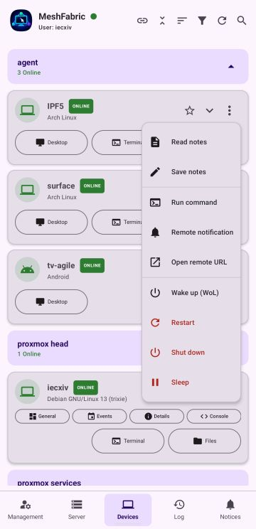<br>Acciones de dispositivo</td>
    <td align="center">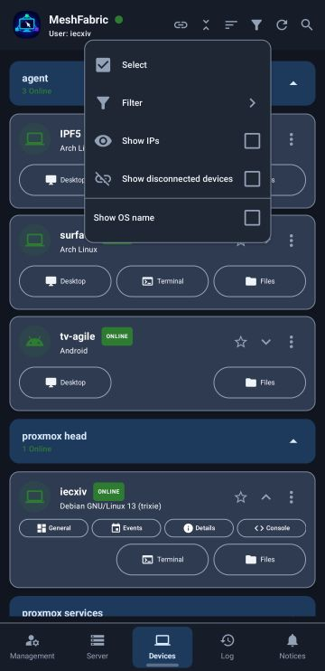<br>Filtros de dispositivos</td>
    <td align="center">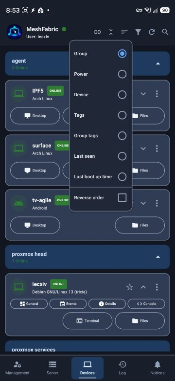<br>Ordenación de dispositivos</td>
    <td align="center">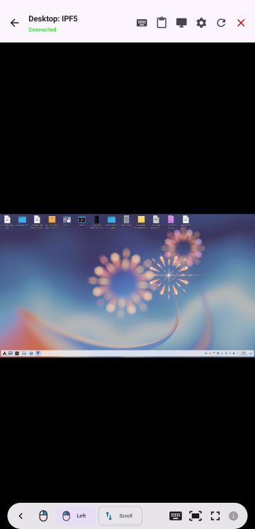<br>Escritorio remoto</td>
  </tr>
  <tr>
    <td align="center">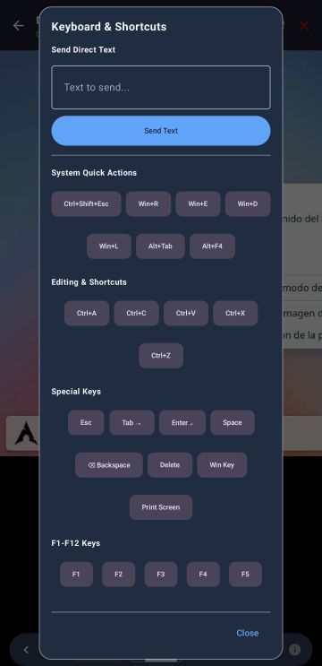<br>Teclado y atajos</td>
    <td align="center">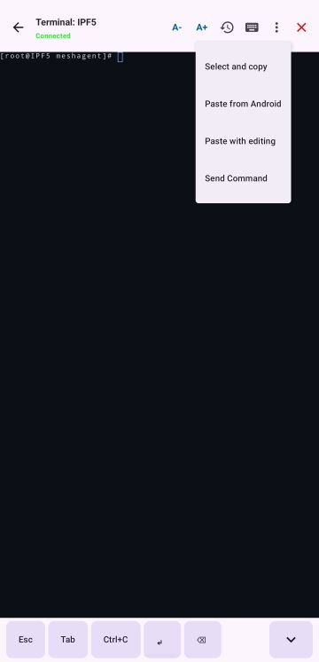<br>Terminal</td>
    <td align="center">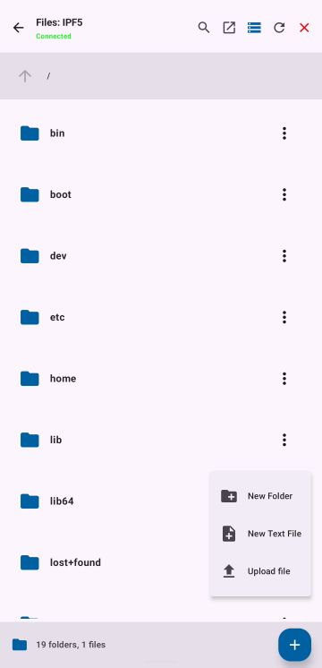<br>Gestor de archivos</td>
    <td align="center">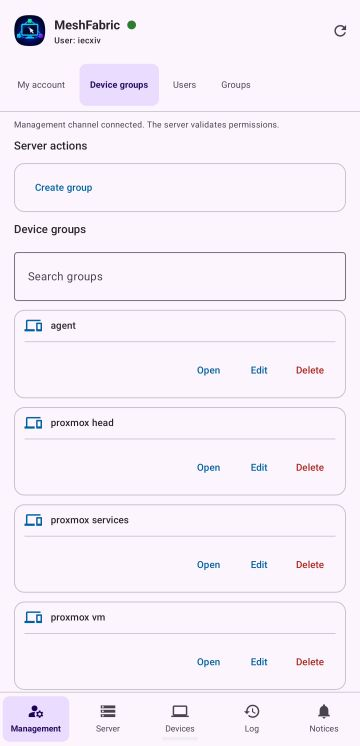<br>Grupos de dispositivos</td>
  </tr>
  <tr>
    <td align="center">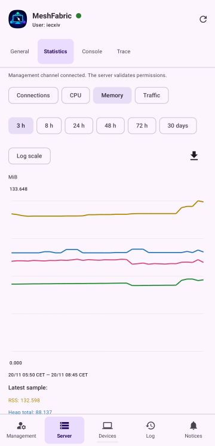<br>Estadísticas del servidor</td>
    <td align="center">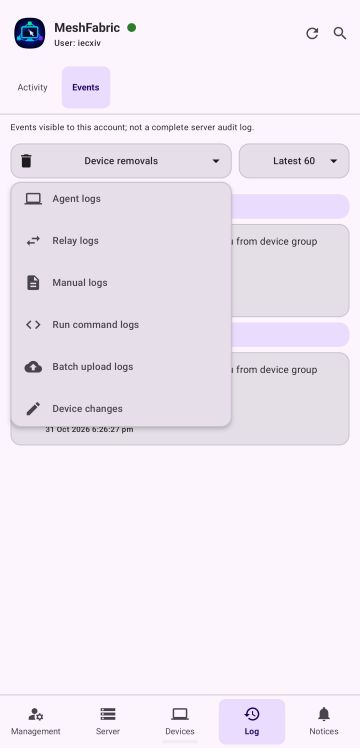<br>Eventos</td>
    <td align="center">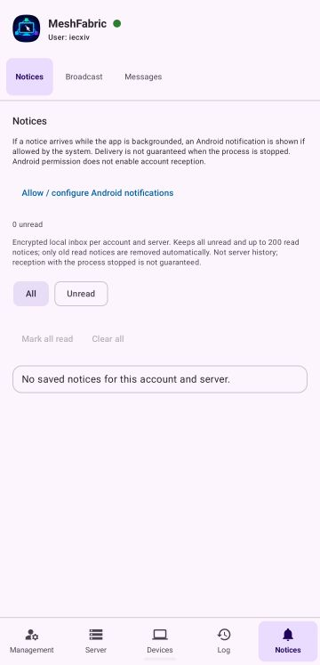<br>Avisos</td>
    <td align="center">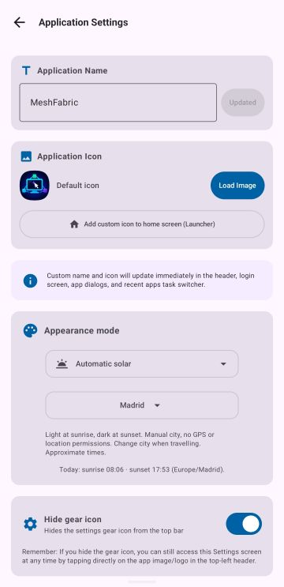<br>Ajustes de la aplicación</td>
  </tr>
</table>
<!-- screenshot-gallery:end -->

## Funciones

### Dispositivos y navegación

- Dispositivos organizados por grupos de MeshCentral, con estado conectado/desconectado e información del sistema operativo.
- Expansión y contracción de grupos, individualmente o todos a la vez, con preferencias guardadas.
- Búsqueda por nombre o sistema operativo.
- Navegación inferior entre Gestión, Servidor, Dispositivos, Registro y Avisos.
- Acceso al escritorio, terminal, archivos y acciones desde cada tarjeta de dispositivo.
- Despliega las opciones de la tarjeta para abrir General, Eventos, Detalles y la Consola del agente. Detalles sigue disponible sin duplicar el icono de información junto a ONLINE/OFFLINE.
- Los filtros de cabecera controlan la visibilidad de dispositivos desconectados y direcciones de red.

### Exploración y acciones por lote

- Ordena y filtra dispositivos, conserva favoritos locales, selecciona equipos o grupos visibles y exporta una selección revisada como JSON.
- El nombre del sistema operativo está activado por defecto si no hay elección guardada; alternarlo no cambia el resaltado del icono de filtro.
- Las acciones revisadas incluyen energía, etiquetas, notificaciones, comandos, movimiento de grupo, actualización y núcleos del agente, desinstalación, eliminación de dispositivos y subida de archivos, según requisitos y permisos verificados.
- Los diálogos se adaptan al contenido y al espacio disponible, con título y botones fuera del cuerpo desplazable. Se distinguen resultados aceptados, encolados, sin confirmar y verificados.

### Gestión nativa y seguridad de cuenta

- Gestión ofrece Mi cuenta, Grupos de dispositivos, Usuarios y Grupos (de usuarios).
- Administra usuarios, grupos de usuarios, membresías individuales y accesos a grupos de dispositivos según los permisos del servidor.
- Revisa concesiones, cambios de derechos y retiradas antes de confirmarlos por separado; se distinguen accesos directos y heredados.
- Gestiona de forma nativa contraseña, autenticador, claves de seguridad existentes, códigos de respaldo, historial de accesos y tokens.
- Tu propia ficha ofrece dos acciones de contraseña y MFA. Contraseña abre directamente su diálogo de Mi cuenta; MFA abre un selector de opciones. Mensajes, bloqueo/desbloqueo y eliminación administrativa se ocultan para tu propia cuenta.
- Envía Broadcast o notificaciones individuales con revisión; la aceptación del servidor no garantiza entrega ni lectura.
- Utiliza una bandeja de avisos persistente cifrada por servidor/cuenta, alertas Android opcionales en segundo plano y preferencias sincronizadas con la web. Los no leídos no se eliminan automáticamente y se guarda el estado local de lectura.

Guías: [Gestión](docs/es/profile.md), [Mi cuenta](docs/es/profile-native.md), [Administración de usuarios y accesos](docs/es/profile-user-administration.md).

### Búsqueda en Gestión y preferencias locales

- La búsqueda del directorio se abre y cierra desde la cabecera y admite hasta 256 caracteres.
- La búsqueda dentro de un grupo filtra únicamente sus dispositivos. Cada grupo conserva su consulta al volver al directorio, cuyo filtro se mantiene por separado.
- La búsqueda del grupo se oculta en Accesos y Resumen; regresar a Dispositivos recupera su consulta. Atrás primero cierra la búsqueda de dispositivos del grupo abierta; otra pulsación vuelve al directorio.
- Cerrar sesión conserva las preferencias locales de la aplicación, no una sesión autenticada.

Las pruebas de integración de pantalla completa cubren cambios de sección, navegación con Atrás y límites de entrada, también con escala de fuente de 1,8. La suite permanente incluye once clases instrumentadas y el mantenedor confirma ambos jobs de CI en verde para la corrección de búsqueda. Los datos de sesión controlados no validan permisos ni entrega contra un servidor real.

El mantenedor confirma manualmente el inicio de sesión, Compartir y el retorno desde segundo plano al escritorio remoto y al terminal en el entorno probado. Los permisos con roles restringidos, la recepción de eventos y la actualización de inventarios siguen pendientes de comprobación contra el servidor real. Estas confirmaciones no cubren todos los servidores/dispositivos, el retorno al gestor de archivos ni la recuperación tras morir el proceso. Consulta [Gestión y alcance de validación](docs/es/profile.md).

### Llaves de seguridad (FIDO2/WebAuthn)

- Inicio de sesión nativo con llave de seguridad y verificación de la cuenta autenticada antes de completar el acceso.
- Alta, consulta y baja de llaves desde Mi cuenta.
- La autenticación permanece dentro de la app, restringida al servidor seleccionado, sin navegador externo y con cancelación ante errores TLS.

Las comprobaciones físicas con la YubiKey 5 NFC utilizada durante el desarrollo incluyen alta, baja y login, también por USB; el alta por NFC ya estaba confirmada. Estas pruebas no garantizan todas las llaves, transportes o configuraciones de servidor.

Guía: [FIDO y alcance de validación](docs/es/fido.md).

### Avisos, Broadcast y Mensajes

- Avisos conserva entradas recibidas; Broadcast y Mensajes reutilizan los flujos revisados y sujetos a permisos. Mensajes distingue usuarios y dispositivos y no es un historial de chat.
- Los destinatarios muestran el nombre del usuario o dispositivo (grupo), sin IDs internos visibles. La búsqueda de Mensajes empieza oculta, se abre con la lupa y filtra nombres/grupos visibles. Cerrar la búsqueda, cambiar de pestaña o de tipo de destinatario limpia el filtro.
- La bandeja restaura no leídos y estado de lectura al abrir de nuevo y autenticar la misma cuenta/servidor. Entrar en Avisos o descartar una alerta Android no marca como leído. Restaurar no vuelve a emitir alertas.
- Se conservan todos los no leídos y hasta 200 leídos. El almacenamiento usa AES-GCM con clave de Android Keystore, archivos atómicos y almacenamiento privado excluido de backups. Esta bandeja no tiene alternativa en texto plano.
- El límite por cuenta/servidor es de 16 MiB. Si falla o se supera, el guardado queda sin confirmar y conserva el archivo anterior; puede haber cambios solo en memoria. Espera a que termine el guardado antes de cerrar. Vaciar la bandeja también elimina los no leídos tras confirmar.
- La navegación de diálogos de Gestión y los resultados de Servidor admitidos sobreviven a pausas temporales. Los detalles de Eventos sobreviven a pausas de ciclo de vida verificadas y exigen autorización coincidente y un evento inequívoco al recargar. No restaura diálogos tras morir el proceso; las confirmaciones sensibles pueden invalidarse.
- Actividad sigue siendo un diario independiente en memoria. Consola/Seguimiento siguen borrando sus búferes al pasar a segundo plano. La aceptación del servidor no demuestra entrega/lectura y no se garantiza recepción con el proceso detenido.

Guía y lista de aceptación: [Avisos y continuidad](docs/es/notices.md). Siguen pendientes las comprobaciones en dispositivo y de entrega contra el servidor real.

### Estado de conexión y estabilidad de diálogos

- Los indicadores compartidos del canal de gestión conservan las mismas dimensiones entre conectando, conectado y desconectado para un mismo ancho disponible y escala de fuente. Reconectar se integra en el texto desconectado, sin añadir un botón lateral. Los textos de estados ocultos quedan fuera de la semántica de accesibilidad.
- Broadcast y Mensajes utilizan el espaciado compartido entre estado y contenido, sin añadir un margen vertical propio alrededor del indicador.
- Gestión ya no inserta un aviso temporal de datos anteriores por encima de sus pestañas. El estado se muestra en el indicador existente y las acciones permanecen bloqueadas si faltan datos actuales o autorización.
- La ficha de grupo de dispositivos realiza una carga automática por grupo abierto y generación real de conexión, cuando están disponibles los datos necesarios. Terminar esa carga no dispara otra; Actualizar sigue siendo una acción explícita.
- La continuidad no es restauración ilimitada: cambios de identidad, permisos, inventario o selección pueden invalidar el contexto. Las confirmaciones sensibles mantienen sus reglas y los diálogos no se restauran tras morir el proceso.

### Instalación de agentes e invitaciones

- Abre un grupo con agente en Gestión para utilizar Agregar agente o Invitar. Invitar no está en el menú de tres puntos de las tarjetas de Equipos/Dispositivos.
- Agregar agente ofrece instaladores admitidos, arquitecturas, comandos Linux/BSD, opciones de Assistant y configuración Android mediante APK/QR. La app no ejecuta instaladores ni comandos.
- Invitar genera un enlace para instalar un agente e incorporarlo al grupo seleccionado; no concede acceso temporal a un dispositivo existente ni envía correo.
- La generación es explícita. Los resultados desconocidos no se presentan como éxito ni se reintentan automáticamente. El guardado exige una copia no vacía y verificada mediante relectura.
- Las pruebas automatizadas no sustituyen comprobar la incorporación al grupo previsto contra el servidor real.

Guía: [Instalación de agentes e invitaciones](docs/es/agent-installation.md).

### Escritorio remoto

- El estado incluye el número de visores comunicado por el servidor cuando hay más de uno, por ejemplo Conectado, 2 viendo. Varias conexiones de la misma cuenta se cuentan por separado; no se inventa un contador si faltan metadatos válidos.
- La barra arrastrable llega a ambos bordes verticales y conserva su posición relativa al expandirse o plegarse. El estado de la vista se conserva entre reconexiones automáticas dentro de la sesión de la app.
- Reanudar y refrescar utilizan paquetes distintos; el intervalo de imágenes se envía con la compresión, sin un bucle de refrescos periódicos. No garantiza compatibilidad con todos los servidores o agentes.

- Escritorio remoto nativo (KVM) con control táctil del ratón, clic izquierdo/derecho, desplazamiento, zoom y movimiento de la imagen.
- Teclado virtual y atajos como Ctrl+Alt+Supr, Win+R, Alt+Tab y teclas de función, sujetos al entorno y a las restricciones del sistema remoto. Los atajos personalizados se muestran como botones; arrastra su asa para reordenarlos y pulsa la cruz para quitar uno.
- Configuración de calidad, escala, frecuencia de imágenes y codificación.
- Controles de portapapeles y sincronización opcional, sujetos a las restricciones de la sesión y del servidor.
- Intercambio de botones del ratón, dirección de la rueda, distribución remota del teclado y bloqueo al desconectar.
- La captura de gestos se renueva cuando cambian las dimensiones del área visible o de la imagen ajustada. Comprueba clics, pulsaciones largas y desplazamiento después de girar el dispositivo.

#### Pantallas y controles

- Selecciona un monitor remoto o Todas las pantallas cuando lo permita el agente; no se inventan capacidades ausentes.
- Un selector persistente alterna clic izquierdo y derecho, mantiene la misma anchura en ambos estados y resalta en el azul del tema el botón del ratón activo. Scroll tiene botón propio y permite recuperar el modo de clic recordado al abandonarlo. En modo Scroll, un toque corto con dos dedos en cualquier parte del lienzo, sobre la imagen del escritorio o la zona negra, abandona Scroll y activa el clic izquierdo sin enviar ningún clic.
- Un botón de clic derecho con insignia numérica se sitúa después del colapsador de la barra. Con la insignia activa, cada cambio a clic derecho dura un solo clic y después vuelve a clic izquierdo; con la insignia apagada, el clic derecho permanece seleccionado hasta que lo cambies. El ajuste se recuerda hasta que lo desactives. Información permanece al final.
- Las sesiones nuevas empiezan en clic izquierdo; reconectar o girar una sesión existente conserva su modo.

#### Teclado físico y teclado en pantalla

La gestión nativa de pulsación y liberación admite teclados físicos y teclados virtuales que emitan eventos de tecla. El mapeo incluye flechas, navegación, Tab, Intro, Escape, Retroceso/Supr, Insert, Inicio/Fin, RePág/AvPág, F1–F12, letras, números, teclado numérico, puntuación y modificadores cuando Android los entrega a la aplicación.

- Los eventos reconocidos se consumen antes de que el campo de texto oculto los procese, evitando movimientos locales del cursor o ediciones duplicadas.
- La captura del teclado físico no requiere abrir el teclado en pantalla.
- Se admiten repeticiones de pulsación y seguimiento equilibrado de modificadores.
- La captura se suspende con diálogos abiertos o con la pantalla inactiva. Al perder el foco o el control de entrada se intenta liberar las teclas registradas, sin reproducirlas en otra sesión.
- Los eventos de texto del IME y el transporte Unicode permanecen separados de los eventos de tecla.

Esto aborda problemas como las flechas de Hacker's Keyboard que no llegan al escritorio remoto, pero no garantiza compatibilidad universal. Las pruebas simulan eventos marcados como procedentes de un teclado virtual; no ejecutan el APK real de Hacker's Keyboard. Sigue siendo necesaria la verificación en dispositivos y equipos remotos reales.

Existen limitaciones con teclas reservadas por Android, distribuciones remotas, AltGr, bloqueos y teclado numérico, modificadores izquierdo/derecho, composición del IME, mezcla con la barra de herramientas, juegos, códigos de exploración y atajos protegidos del sistema. Una liberación enviada después de fallar el transporte no garantiza su recepción remota.

Consulta [Entrada de teclado del escritorio](docs/es/desktop-keyboard-input.md).

### Terminal

- Terminal interactivo mediante el relay del agente MeshCentral, con ajuste del tamaño de fuente y renderizador local WebView/xterm retenido.
- El icono superior del teclado muestra u oculta explícitamente el teclado. El editor de comandos sigue disponible en el menú de herramientas.
- Las solicitudes de foco del terminal se bloquean mientras un menú o diálogo controla la entrada. Al cerrarlo se restaura el foco sin abrir automáticamente el teclado.
- Las solicitudes de foco obsoletas se cancelan al perder el foco de ventana, pasar a segundo plano, separar o destruir la vista.
- Se solicita a los IME compatibles que eviten la edición a pantalla completa y el aprendizaje personalizado; pueden ignorar estas indicaciones.

#### Panel de historial

- El icono Historial está entre A+ y el teclado. Los controles de cabecera usan diseños compactos de 36 dp.
- Pulsarlo con el panel oculto lo abre expandido; pulsarlo con el panel visible lo oculta por completo. El icono solo se colorea mientras el panel está visible y no tiene un desplegable independiente.
- Una desconexión involuntaria de una conexión establecida muestra el panel contraído una vez por incidente. Restaurar historiales o cerrar explícitamente con X no activa esta presentación automática.
- La flecha del panel expande o contrae el contenido. Cabecera y contenido comparten superficie, fondo y borde redondeado de ancho completo.
- Reconectar, Volver al terminal actual o Cancelar aparecen en la cabecera según el estado, sin entradas duplicadas en la lista.
- Los historiales anteriores se abren en modo de solo lectura y se eliminan individualmente o todos juntos. La eliminación requiere confirmación y excluye la sesión actual.

#### Selección y copia

Seleccionar y copiar, en el menú de herramientas, abre una captura nativa de solo lectura; no selecciona directamente sobre el lienzo del terminal activo.

- Mantén pulsado el texto para seleccionar un fragmento y usar la barra nativa de copia.
- Copiar todo copia la captura completa.
- La extracción une líneas divididas por ajuste visual, conserva los saltos reales y excluye el relleno vacío del área visible.
- La captura se limita a 2000 filas recientes y 200000 unidades UTF-16. El truncamiento se indica y no divide pares sustitutos UTF-16.
- Se captura el búfer activo: una aplicación a pantalla completa no expone el búfer normal oculto mediante esta acción.
- La copia es explícita y no envía entrada al shell remoto.

#### Pegado y edición antes de enviar

El menú ofrece Pegar desde Android, para revisar el texto del portapapeles antes de confirmarlo, y Pegar con edición, para modificarlo en un campo multilínea antes de enviarlo.

Abrir un diálogo o editar su texto no lo envía. Estas acciones no añaden Intro, pero los saltos de línea existentes pueden ejecutar comandos. El texto multilínea requiere aceptación expresa; cambiar el texto editado aceptado restablece esa aceptación.

El límite es de 16384 unidades UTF-16. El texto excesivo, los controles no admitidos y el Unicode mal formado se rechazan sin truncamiento silencioso. Una edición inválida conserva el borrador anterior y muestra un error. El envío usa la API pública de pegado de xterm y su tratamiento de pegado entre delimitadores y finales de línea; esto no garantiza que la aplicación remota procese los comandos con seguridad.

Cada vista previa permite un intento de envío sin reintentos automáticos. La aceptación local no confirma recepción ni ejecución remota. Si el envío no se confirma, revisa el terminal antes de repetirlo. Cancelar no deshace entrada ya enviada. El editor de comandos independiente conserva su comportamiento de envío de comandos y no debe confundirse con estas acciones de pegado.

#### Teclas especiales y desplazamiento

- La barra de teclas es una única fila desplazable horizontalmente con las teclas que elijas. Pulsa la llave inglesa del final para editarla: arrastra el asa para ordenar, pulsa la cruz para quitar una tecla, añade teclas del catálogo (Esc, Tab, flechas, Inicio/Fin, Insert/Supr, RePág/AvPág, Intro, Retroceso y de Ctrl+A a Ctrl+Z), restablece los valores predeterminados y guarda o cancela.
- Las teclas elegidas y la posición de desplazamiento de la barra se recuerdan.
- Las teclas tienen fondo y esquinas pequeñas; conservan un espacio mínimo de interacción y pueden crecer con fuentes grandes para evitar recortes.
- Las flechas usan un mismo icono vectorial girado por dirección. Intro y el control de última salida mantienen un tamaño mayor; Fin usa la tipografía de Inicio.
- Las flechas respetan el modo de cursor de aplicación de xterm. Retroceso envía el byte 8 e Intro envía CR.
- RePág/AvPág/Inicio/Fin son teclas remotas. El control independiente de última salida mueve el historial local del búfer normal al final, sin enviar teclas. No está disponible en el búfer alternativo.
- El desplazamiento táctil sobre el texto usa el área nativa en dispositivos con puntero grueso, dentro del búfer normal y sin informes de ratón activos. Se conserva el comportamiento del búfer alternativo y de los informes de ratón.

Durante ese desplazamiento no se conserva la selección directa ni la apertura de enlaces sobre el lienzo. Para seleccionar texto utiliza el diálogo Seleccionar y copiar. No se garantiza un comportamiento universal con todos los IME ni con todas las aplicaciones de terminal a pantalla completa.

#### Desconexión y reconexión manual

- Un cambio de red o fallo del túnel cierra el transporte sin borrar el historial actual ni reiniciar deliberadamente la posición de desplazamiento de la vista retenida. La salida sigue disponible para lectura y copia.
- El panel informa del estado desconectado y de solo lectura fuera de la salida remota. Escritura, pegado, teclas remotas y solicitudes de teclado permanecen bloqueados incluso si se oculta el panel.
- Reconectar permite un intento candidato por dispositivo, con cancelación y un plazo total de 30 segundos para preparar el canal de control y negociar el terminal. Abrir un WebSocket no basta para confirmar la conexión.
- El fallo, agotamiento del plazo o cancelación cierra el candidato y conserva el registro y la salida anteriores. No hay reintentos automáticos ni comandos en cola para reenviar.
- Una negociación correcta crea una sesión independiente como actual. El historial anterior conserva su propio registro y callbacks; una secuencia de borrado de la nueva sesión no borra ese historial.
- La X roja cierra y archiva explícitamente el terminal actual, cancela la reconexión pendiente y vuelve a Dispositivos. El botón Terminal recupera su estado inicial. Volver atrás no cierra explícitamente la sesión.
- Reconectar no demuestra que el proceso remoto original haya sobrevivido o se haya reanudado. No se garantiza la continuidad de shells ni de aplicaciones como nano. Recrear vista es una acción distinta y no reconecta el transporte.

#### Historial, retención del renderizador y recuperación

- Cerrar un terminal, incluso al cerrar todas las sesiones, archiva su registro sin dejar resaltada una sesión actual. Los archivos históricos son independientes del registro de sesiones actuales.
- Guardar búferes del terminal conserva registros cerrados y puntos de control por servidor/cuenta, restaurados como historiales de solo lectura. Los puntos de control se limitan aproximadamente a uno por segundo, con guardados adicionales al detener la actividad y al archivar mediante el callback de retirada de tareas recientes. Una terminación abrupta puede perder salida todavía no escrita.
- Con la opción desactivada, los historiales solo permanecen en memoria. Desactivarla elimina los archivos guardados y los búferes antiguos. Eliminar un historial borra también su archivo para que no reaparezca al reiniciar.
- La salida persistida no recrea una conexión viva. Consulta [Persistencia de historiales](docs/es/terminal-archive-persistence.md) para almacenamiento, separación de cuentas, migración y límites.
- La caché conserva hasta cuatro renderizadores sin expulsar vistas adjuntas. Un renderizador expulsado puede reconstruirse desde la salida disponible, no desde una instantánea VT completa.
- El truncamiento se indica explícitamente. Reconstruir una vista desconectada puede reproducir desde la salida más antigua disponible: es una recuperación de historial de mejor esfuerzo, no una restauración de datos ausentes ni del estado visual completo.
- La entrega de salida en directo detecta estrictamente huecos, incluida la lectura inicial. Continuar desde un cursor expulsado o invalidado no omite silenciosamente datos perdidos.
- La pérdida del renderizador y los plazos de confirmación del parser en primer plano ofrecen Recrear vista con confirmación. Esto no reinicia el shell; las aplicaciones a pantalla completa pueden necesitar redibujarse.
- El historial retenido no demuestra que el túnel siga conectado ni que el proceso original continúe. La muerte del proceso no conserva el WebView.

Documentación técnica:

- [Selección y copia](docs/es/terminal-selection-copy.md)
- [Vista previa de pegado](docs/es/terminal-paste.md)
- [Pegado con edición](docs/es/terminal-paste-edit.md)
- [Foco e IME](docs/es/terminal-focus-ime.md)
- [Teclas especiales](docs/es/terminal-special-keys.md)
- [Desplazamiento táctil](docs/es/terminal-touch-scroll.md)
- [Retención del renderizador](docs/es/terminal-renderer-retention.md)
- [Supervisión ACK y recuperación de vista](docs/es/terminal-ack-recovery.md)
- [Reconexión manual e historial retenido](docs/es/terminal-manual-reconnect.md)
- [Persistencia de historiales](docs/es/terminal-archive-persistence.md)

### Gestor de archivos y editor de texto

- Exploración de directorios remotos y navegación a una ruta concreta.
- Subida de archivos y descarga a Android.
- Creación de carpetas y archivos de texto; copia, corte, pegado, movimiento, renombrado y eliminación.
- Compresión ZIP y extracción de archivos admitidos, con diálogos de conflictos/sobrescritura y controles de progreso.
- Edición de archivos de texto pequeños considerados candidatos, con fuente monoespaciada, números de línea lógicos, ajuste de línea y desplazamiento. Las continuaciones visuales no generan números de línea adicionales.
- El editor compartido también se utiliza para notas de dispositivos. No incluye resaltado de sintaxis.
- Las operaciones se aplican actualmente a elementos individuales; la selección múltiple sigue pendiente.

### Notas de dispositivos y acciones remotas

El menú de cada dispositivo permite leer y editar/guardar notas, ejecutar comandos o scripts con selección de intérprete según el sistema operativo, enviar notificaciones, solicitar la apertura de URL HTTP/HTTPS, activar Wake-on-LAN y reiniciar, apagar o suspender el equipo.

Las notas incluyen borradores locales, confirmación antes de descartar cambios y verificación de guardado mediante relectura del servidor. El editor admite hasta 64000 caracteres. Guardar el campo vacío elimina las notas existentes.

La salida de comandos se muestra separada del terminal interactivo. Cerrar su ventana no detiene el comando remoto, y recibir salida no demuestra que el proceso haya terminado correctamente.

Enviar o aceptar una solicitud no equivale a ejecutarla. MeshFabric informa de resultados no confirmados e interrupciones en lugar de repetir automáticamente acciones potencialmente disruptivas. Notificaciones, apertura de URL, acciones de energía y WoL dependen del servidor y del entorno remoto.

### General del dispositivo y chat

- General permite editar metadatos y revisar acciones según permisos verificados. Notas, ejecución de comandos, notificaciones, chat y herramientas de consola dependen del servidor y del agente.
- Compartir está disponible según las capacidades del servidor y los permisos de la cuenta. El mantenedor confirma su uso manual en el entorno probado; siguen pendientes los escenarios con roles restringidos.
- El chat admite texto y puede minimizarse en burbujas móviles dentro de la app. Iniciarlo solicita explícitamente al equipo seleccionado abrir su navegador remoto.
- Los chats abiertos se incluyen en el cómputo de sesiones del servicio keep-alive. Pasar a segundo plano ya no los desconecta deliberadamente y utiliza la notificación existente de sesiones activas. Cerrar el chat, terminar su contexto autenticado o retirar la tarea sigue cerrándolo.
- El borrador y el historial permanecen en memoria, sin confirmaciones de entrega/lectura ni reenvío automático. La muerte del proceso y la pérdida de red o permisos pueden terminar el chat.

Guía y lista de aceptación: [Sesiones y chat de dispositivos](docs/es/device-sessions.md).

### Actividad

- Solicitudes locales recientes, eventos del servidor, errores y salida de comandos disponible.
- Búsqueda y filtros por categoría o dispositivo, con agrupación por fecha.
- Identificadores de solicitud, actor, fecha/hora y detalles de resultado cuando están disponibles.
- Hasta 200 entradas en memoria: es una vista de la sesión, no un archivo persistente ni completo de auditoría del servidor.
- Una interrupción del canal conserva las entradas recibidas y marca resultados pendientes como desconocidos, sin reenviar automáticamente. Cerrar sesión, destruir su propietario o terminar el proceso puede borrar este diario; los avisos recibidos persistentes pertenecen a la bandeja independiente de Avisos.

### Eventos

- Registro separa las pestañas Actividad y Eventos. Actividad conserva el diario local de la sesión; Eventos consulta el historial visible para la cuenta del servidor actual. No es un archivo completo de auditoría.
- Los selectores de tipo y cantidad consultan al servidor: 60, 120, 250, 500, 1000 o Sin límite. Sin límite omite el máximo solicitado y no impone topes artificiales de registros, trama o descripción en la app; siguen aplicándose permisos, disponibilidad de respuesta, plazos de espera y recursos del dispositivo. No hay recorte silencioso.
- Refresco y búsqueda están en la cabecera de Eventos. Los resultados visibles se agrupan con bandas de fecha del tema; los eventos sin hora válida tienen su grupo de fecha no disponible.
- Los controles usan reparto 2:1 con anchura máxima conjunta, menús del ancho de sus cabeceros y texto ajustable. Los iconos conservan también los tipos de evento desconocidos.
- Las tarjetas muestran dispositivo (grupo), cuando se puede resolver, sin los campos de identificador de nodo o grupo. Los detalles de solo lectura separan nombre, grupo e identificadores disponibles; los eventos de comandos conservan el comando literal, tipo y modo de ejecución enviados por el servidor.
- Se priorizan los nombres incluidos en el evento. Los que faltan pueden completarse con el inventario de la misma conexión, que no acredita el estado histórico. Se aíslan cambios de cuenta/servidor y respuestas de consultas anteriores.
- Los historiales de acceso comparten colores de resultado y presentación de Edición de usuario; solo el historial de Mi cuenta adopta sus dimensiones de referencia. Los listados de Gestión y Estadísticas del servidor ofrecen refresco en cabecera.
- Las fuentes de rastreo aceptan un null explícito como ninguna fuente activa, distinguen datos ausentes o incompatibles y limitan la espera inicial. Abrir o reconectar no envía escrituras traceinfo que puedan cambiar las fuentes globales. Siguen vigentes las restricciones de administrador y dominio.

Guía técnica: [Registro y Eventos](docs/log.md) (en inglés). Referencia de protocolo: [Fuentes de rastreo](docs/reference/meshcentral-1.3.1-trace-sources.md) (en inglés).

### Sesiones en segundo plano y notificación

- Los chats abiertos se cuentan junto al escritorio, terminal y archivos, incluso si solo queda un chat. Al cerrarlos se actualiza la decisión del servicio sin retirar otras sesiones activas.
- Se utiliza una notificación de servicio en primer plano cuando hay sesiones que la necesitan mientras la app está en segundo plano.
- Al pulsarla se solicita volver a MainActivity mediante un PendingIntent de actividad explícito e inmutable. No usa flags de limpieza de tareas ni solicita explícitamente desconectar o reiniciar el terminal.
- El regreso sigue el ciclo de vida de la app. Si el proceso murió, hace falta el inicio normal; la notificación no garantiza recuperar una sesión remota viva anterior.

### Apariencia e idiomas

- Interfaz Material 3 con Sistema, Claro, Oscuro, Programado y Automático solar.
- Programado utiliza horas editables de claro y oscuro en la zona horaria del dispositivo. El modo solar usa una ciudad elegida manualmente del catálogo incluido y cálculos locales, sin GPS, permisos de ubicación ni consultas de red. Sin ciudad o sin eventos solares se usa temporalmente el modo del sistema.
- El selector y sus controles adicionales son compactos y centrados; los iconos y textos del menú mantienen columnas alineadas.
- Nombre e icono personalizados y opción para ocultar el icono de ajustes.
- Se comprueban declaraciones de recursos y compatibilidad de formatos en inglés y español. Los literales, la accesibilidad, los recursos web y el significado de las traducciones requieren revisión; la salida remota no se traduce automáticamente.

Consulta [Controles de dispositivos y acciones por lote](docs/es/device-controls.md) y [Auditoría de traducciones](docs/es/i18n/README.md). La auditoría no declara traducidas todas las frases visibles.

## Requisitos

- Servidor MeshCentral accesible y cuenta válida.
- Dispositivos/agentes con la función remota solicitada y permisos suficientes en el servidor.
- Android 8.0 o posterior (API mínima 26).

| Configuración | Valor |
| --- | --- |
| SDK mínimo | `26` |
| SDK de compilación | `37`, API menor `2` (`platforms;android-37.2`) |
| SDK objetivo | `35` |
| Compatibilidad de código fuente/destino Java | `17` |
| Build Tools | `37.0.0` |

La configuración está en `app/build.gradle.kts`.

## Compilar desde el código fuente

1. Clona el repositorio:

   ```bash
   git clone --branch main https://github.com/iecxiv/meshfabric.git
   cd meshfabric
   ```

2. Abre el proyecto en una versión de Android Studio compatible con Android Gradle Plugin y el wrapper de Gradle configurados en el repositorio. Instala Android SDK Platform 37.2 (`platforms;android-37.2`), Build Tools 37.0.0 y Platform Tools, y sincroniza Gradle. La CI validada usa Android Command-line Tools 23.0 e instala también Platform 35 para su entorno de pruebas API 35. compileSdk no cambia el mínimo API 26 ni targetSdk 35.
3. Selecciona un JDK de Gradle compatible con esas herramientas. Las verificaciones usan JDK 21; la compatibilidad del código fuente/destino Java permanece en 17. Son ajustes distintos.
4. Compila y ejecuta en un dispositivo o emulador con API 26 o posterior.

APK de depuración desde la raíz:

```bash
# macOS / Linux
./gradlew :app:assembleDebug

# Windows
.\gradlew.bat :app:assembleDebug
```

Tras una compilación correcta, el APK está en `app/build/outputs/apk/debug/`. Las herramientas de compilación se definen en `gradle/libs.versions.toml` y `gradle/wrapper/gradle-wrapper.properties`.

## Verificación

Antes de integrar en dev se ejecutan la suite JVM sin filtros, toda la suite instrumentada Android, los scripts de pruebas JavaScript y lint. Las validaciones acotadas por funcionalidad no sustituyen esta comprobación de integración. Los APK se compilan e instalan una sola vez y se conserva evidencia de los métodos realmente ejecutados.

Pruebas JVM:

```bash
./gradlew :app:testDebugUnitTest
```

Comprobaciones JavaScript del terminal con Node.js:

```bash
node app/src/test/js/terminal-runtime.test.js
node app/src/test/js/terminal-selection.test.js
node app/src/test/js/terminal-keys.test.js
```

Compilación y ejecución de pruebas instrumentadas con dispositivo conectado o emulador activo:

```bash
./gradlew :app:assembleDebugAndroidTest :app:connectedDebugAndroidTest
```

La verificación incluye mapeo de teclas y modificadores, entrada Compose, barra de teclas, eco/copia/pegado en xterm incluido, foco/IME y desplazamiento táctil. Las pruebas unitarias también cubren propiedad de intentos de terminal, finalizaciones obsoletas, lecturas estrictas frente a reproducción explícita, apertura del panel y almacenamiento de historiales.

Las pruebas instrumentadas del panel comprueban contenido oculto, etiquetas duplicadas de acciones principales y expansión mediante su flecha. Compilarlas no significa ejecutarlas. Las pruebas JVM y un build correcto no verifican por sí solos la alineación de clics tras zoom/giro ni la navegación desde notificaciones en un dispositivo físico.

Algunos cambios usan workflows de publicación: el commit del workflow no es el cambio funcional. Comprueba que el commit funcional se publicó y revisa el resultado de validación.

Superar pruebas automatizadas no garantiza compatibilidad universal con Hacker's Keyboard, teclados físicos, IME, entornos Android ni todos los equipos Windows/Linux. Comprueba escritura, atajos, idiomas/acentos, composición, repeticiones, cambios de foco, reconexión, tamaño de fuente y orientación horizontal en los dispositivos previstos.


La aceptación de Avisos y continuidad de diálogos sigue requiriendo comprobación manual en dispositivo/servidor: lectura y no leídos al reabrir, separación de cuentas/servidores, descarte de alertas Android, persistencia del borrado, navegación al volver de segundo plano y transiciones de estado sin desplazamientos. El éxito automatizado no demuestra esos escenarios físicos ni la entrega.

## Tecnología

- Kotlin y Jetpack Compose con Material 3.
- ViewModels de estilo MVVM, Kotlin Coroutines y StateFlow.
- WebSockets y HTTP de OkHttp para los canales de control y relay de MeshCentral.
- xterm.js incluido localmente para renderizado y entrada del terminal.
- AndroidX Security Crypto para preferencias de sesión cifradas cuando la inicialización funciona.

## Seguridad y operación

- Los datos recordados incluyen URL del servidor, usuario y cookie de autenticación. No se guarda la contraseña de inicio de sesión.
- Las preferencias usan EncryptedSharedPreferences con clave maestra de Android KeyStore cuando está disponible. Si falla la inicialización cifrada, se usan SharedPreferences privadas normales: no asumas que las sesiones recordadas siempre están cifradas.
- La salida guardada del terminal no está cifrada. Los registros JSON se guardan en almacenamiento privado excluido de backups, separados por claves hash de servidor/cuenta. Desactivar Guardar búferes elimina historiales guardados y archivos antiguos; el historial puede seguir en memoria durante esa ejecución. Consulta [Persistencia de historiales](docs/es/terminal-archive-persistence.md).
- La copia del terminal marca el contenido del portapapeles como sensible para ocultar vistas previas compatibles. No cifra el portapapeles ni impide otros lectores autorizados.
- Trata portapapeles, salida retenida y logs de diagnóstico como potencialmente sensibles. No asumas que todas las rutas de diagnóstico han sido auditadas contra divulgación de contenido.
- Ignorar errores SSL debilita la verificación de certificados. Utiliza certificados de confianza y deja esa opción desactivada fuera de entornos controlados.
- Los permisos de cuenta, políticas del servidor y capacidades del agente son la autoridad. Un botón disponible o una solicitud enviada no elude la autorización del servidor.
- Revisa destinatarios y contenido antes de enviar comandos o acciones de energía. Comprueba el dispositivo remoto antes de repetir una acción de resultado desconocido.

## Hoja de ruta y carencias conocidas

No se presentan como funciones completadas:

- Tratamiento más completo de permisos efectivos en la interfaz.
- Compartir dispositivos/sesiones.
- Mayor cobertura de inventario de hardware/software más allá de la ficha de dispositivo implementada.
- Filtros avanzados y favoritos, más allá de búsquedas y filtros actuales.
- Exportación de inventario/actividad.
- Selección múltiple y operaciones masivas de archivos.
- Reconexión automática del terminal, restauración avanzada y validación más amplia de reconexión. La salida retenida no restaura ni demuestra continuidad del proceso remoto original.
- Localización completa inglés/español de la gestión nativa.
- Validación más amplia de teclados, distribuciones, AltGr, IME, giro/zoom y navegación desde notificaciones en dispositivos reales.

## Licencia

Bajo la [Licencia Apache, versión 2.0](LICENSE).

## Índice de documentación técnica

Consulta el [índice de guías en español](docs/es/README.md).
